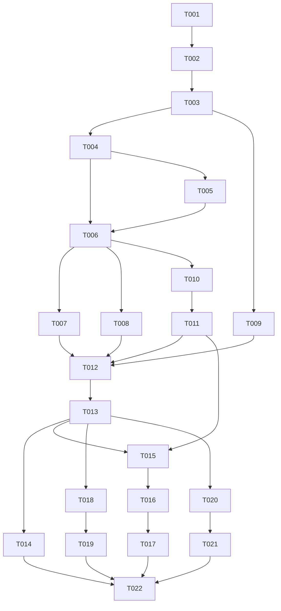

---
aliases:
  - Extract Entry Selection Tasks
tags:
  - sdd
  - tasks
  - extraction
  - rust
created: 2026-11-06
status: done
related:
  - "[[spec]]"
  - "[[plan]]"
  - "[[constitution]]"
---

# Implementation Tasks: Extract Entry Selection and Path Stripping

> [!info] References
> **Spec**: [[spec]]
> **Plan**: [[plan]]
> **Total tasks**: 22
> **Track**: `core-selection` (T-001 to T-014), then CLI (T-015 to T-017), Python (T-018, T-019), Node (T-020, T-021) in their W2 steps; T-022 closes the batch.

> [!success] Done in the #981 batch
> All tasks are implemented; see [[plan]] section 10 for the names that changed (`route_entry_in` instead of `admit`, `dispositions(&SecurityConfig)`, `UnmatchedInclude` top-level, bindings take the selection on `SecurityConfig`). T-014 differential ran against bsdtar only.

> [!note] Preconditions
> The track worktree branches from the post-W0 tip (`73d694b` or later) of `feat/981-exarch-v-panics-with-exit-101`, and `git merge-base --is-ancestor <W0-sha> HEAD` is checked after creation. Core-staging and #972 are merged before T-004 starts. Every task keeps `cargo clippy --workspace --all-targets --all-features -- -D warnings` and the workspace nextest run green.

## Progress

- [x] T-001: Shared pattern type
- [x] T-002: `StripComponents`, `PathRewrite::{Keep, Strip}`, `EntrySelection` and builders
- [x] T-003: `SecurityConfig::selection` and `for_listing`
- [x] T-004: Shared admission gate
- [x] T-005: `max_file_count` charge audit
- [x] T-006: Selection and strip in TAR, ZIP, 7z hosts and sinks
- [x] T-007: Links under strip and selection
- [x] T-008: Unmatched include error and rollback
- [x] T-009: `AtomicReplace` refusal
- [x] T-010: Manifest selection, `dispositions`, projection
- [x] T-011: `verify` parity and integrity scope
- [x] T-012: `PathRewrite::Flatten`
- [x] T-013: Flatten collisions and link refusal
- [x] T-014: Differential, fuzz and bench
- [x] T-015: CLI flags
- [x] T-016: CLI output
- [x] T-017: CLI tests
- [x] T-018: Python surface
- [x] T-019: Python tests
- [x] T-020: Node surface
- [x] T-021: Node tests
- [x] T-022: Spec sync, skill and CHANGELOG hand-off

## Dependency Graph

## Tasks

### T-001: Shared pattern type

- **Spec**: FR-004
- **Files**: `creation/filters.rs`, new `selection` module, `lib.rs` root re-exports
- **Do**: move the exclude-pattern grammar (`Exact`, `Prefix`, `Suffix`, `Path`, replaced by the glob grammar of spec 023, `TryFrom<&str>`, `Display`, `ConfigSetting` selection by caller) to a shared module and expose it as `EntryPattern` (since #1041 the only name; the former `ExcludePattern` and `ExcludeRefusal` are `EntryPattern` and `PatternRefusal`). The refusal setting is a parameter of the parser (`ExcludePattern` for create, `EntryInclude`/`EntryExclude` for extraction).
- **Acceptance**: the existing create tests pass unchanged; one grammar test suite covers both; no second parser exists.
- **Complexity**: S

### T-002: `StripComponents`, `PathRewrite::{Keep, Strip}`, `EntrySelection`

- **Spec**: FR-001, FR-002, FR-003, FR-006
- **Files**: `selection` module, `limit.rs`
- **Do**: add `StripComponents(NonZeroUsize)` with the `i64` boundary parse (refuses `0`, negatives, above `max_path_depth` as `InvalidConfiguration{StripComponents, ..}`), `PathRewrite` (`#[non_exhaustive]`, `Keep` default, `Strip`; `Flatten` arrives in T-012), `EntrySelection` with private fields and `selects`, and the `Selected`, `Rewritten` types with a private constructor.
- **Acceptance**: unit tests for include, exclude, exclude-wins, `Path` subtree, raw-byte matching, normalization (`./`, `\`, drive, root; FR-013); `Rewritten` is constructible only by the rewrite function; doc tests with `# Examples`.
- **Complexity**: M

### T-003: `SecurityConfig::selection` and `for_listing`

- **Spec**: FR-001, FR-050, Q1
- **Files**: `config.rs`
- **Do**: add the `selection` field, builders `with_include`, `with_exclude`, `with_strip_components`, `with_selection`; `for_listing` keeps the selection; update the config doc and the existing `for_listing_resets_write_time_flags_only` test.
- **Acceptance**: a config built with a selection is the value `ListRequest::for_extraction` sees; default config is byte-for-byte unchanged.
- **Complexity**: S

### T-004: Shared admission gate

- **Spec**: FR-010, FR-012, FR-015, FR-016, NFR-009
- **Files**: `formats/common.rs`, `formats/target.rs`, `inspection/landing.rs`
- **Do**: introduce `admit(entry, config) -> Admission::{Extract(Rewritten), Skip(SkipKind)}` as the one per-entry decision, folding the #972 extension allowlist into it in the order of plan section 2.3; `Tally` gets the two new record methods next to `record_extension_skip`; `land` calls `admit`.
- **Acceptance**: with the default selection every existing test passes unchanged; no format handler contains its own match or strip; the second `SafePath` validation consumes only `Rewritten`.
- **Complexity**: M

### T-005: `max_file_count` charge audit

- **Spec**: FR-040, Q15
- **Files**: `formats/*`, `inspection/*`, `sink.rs` (read first)
- **Do**: read how extract, list and verify charge allowlist skips to `max_file_count` today, record the finding in the track handoff, align the three to one rule, and add the regression test (mirrors #831, #846). Selection skips use the aligned rule.
- **Acceptance**: a test per operation shows the same charge for an allowlist skip and for a selection skip.
- **Complexity**: S

### T-006: Selection and strip in all formats and destinations

- **Spec**: FR-005, FR-007, FR-011, FR-014, FR-016, FR-040, FR-042, FR-045
- **Files**: `formats/{tar,zip}.rs`, `formats/sevenz/*`, `formats/target.rs`, `sink.rs`
- **Do**: route every entry kind through `admit`; selection skips create no directory and charge no size quota; compressed TAR skipped data uses the existing ratio-bounded drain; progress reports skips.
- **Acceptance**: unwrap, `top/` stripped, N-or-fewer components, `./` and drive prefix, `top/../x` refused as `PathTraversal` before selection, unselected unsafe path refused, ZipBomb scope `SkippedEntries`; identical results for TAR (all codecs), ZIP, 7z across `HostTarget`, `MemorySink`, custom sink.
- **Complexity**: L

### T-007: Links under strip and selection

- **Spec**: FR-030 to FR-033, Q6
- **Files**: `formats/target.rs`, `sink.rs`, `inspection/landing.rs`, error module
- **Do**: validate symlinks at the rewritten landing with the original target; map hardlink targets through `admit`; add `ArchiveError::HardlinkTargetNotExtracted{link, target}` with `ErrorCode` and `FfiKind` mappings; link projection in `VirtualTree` runs on rewritten paths.
- **Acceptance**: `top/link -> ../other/x` with strip 1 is `SymlinkEscape`; hardlink to an unselected, stripped or wrapper target is refused; hardlink with both ends selected lands.
- **Complexity**: M

### T-008: Unmatched include error and rollback

- **Spec**: FR-043, FR-044, FR-103, Q3
- **Files**: format handlers' end-of-scan, `api.rs`, error module
- **Do**: per-run include hit set; at the end of the scan, `ArchiveError::UnmatchedInclude{patterns}` wrapped in `Partial`; `Atomic` rolls back, `AtomicReplace` is refused earlier (T-009); no pre-pass.
- **Acceptance**: error names every unmatched pattern; unmatched exclude is no error; `Atomic` commits nothing.
- **Complexity**: M

### T-009: `AtomicReplace` refusal

- **Spec**: Q7, [[015-atomic-force-destination-swap-hardening/spec]]
- **Files**: `api.rs` (`extract_staged`)
- **Do**: refuse `Staging::AtomicReplace` with a non-default selection or strip as `InvalidConfiguration{EntrySelection, NotSupported}` before the archive is opened.
- **Acceptance**: refusal test; `Atomic` and `InPlace` unaffected; default selection under `AtomicReplace` unchanged.
- **Complexity**: S

### T-010: Manifest selection, `dispositions`, projection

- **Spec**: FR-051, FR-053, Q12
- **Files**: `inspection/manifest.rs`, `inspection/landing.rs`, `inspection/list.rs`, `request.rs`
- **Do**: the manifest stores the `EntrySelection` it was listed with; `dispositions()` yields `(entry, Disposition)`; `landing_paths` and `landings` project through the stored selection; `total_size()` counts every entry.
- **Acceptance**: a config with a different selection passed to `landings` does not change the result; skipped entries are omitted; every scanned entry is charged to `max_file_count`.
- **Complexity**: M

### T-011: `verify` parity and integrity scope

- **Spec**: FR-050, FR-052, FR-054, SC-003, Q13
- **Files**: `inspection/verify.rs`, `inspection/integrity.rs`
- **Do**: `verify` uses `admit`, reports every refusal extraction raises, validates original paths of unselected entries, and with `--check-integrity` decodes unselected entries too.
- **Acceptance**: parity test (landings and refusals) for TAR, ZIP, 7z, `MemorySink`; an archive extract refuses under a selection is a verify issue.
- **Complexity**: M

### T-012: `PathRewrite::Flatten`

- **Spec**: FR-060
- **Files**: `selection` module, `config.rs`
- **Do**: add `Flatten` to `PathRewrite` and `with_flatten`; the rewrite keeps the final component of regular files and skips directories as `StrippedAway`. Starts only after T-007, T-008, T-009 and T-011 pass the full gate.
- **Acceptance**: flatten lands each regular file by its final component; strip and flatten cannot combine (one enum).
- **Complexity**: S

### T-013: Flatten collisions and link refusal

- **Spec**: FR-061, FR-062, Q9, Q10
- **Files**: `selection` module, `inspection/landing.rs`, gate
- **Do**: collisions on the final component under the destination `PathModel` follow `ExistingFiles` and report `Duplicate`; symlink and hardlink entries under `Flatten` are refused with a typed error naming the entry.
- **Acceptance**: `a/X` and `b/x` collide on `Portable`; `Skip`, `Overwrite`, `Refuse` outcomes tested; a link entry under flatten is refused.
- **Complexity**: M

### T-014: Differential, fuzz and bench

- **Spec**: SC-001, SC-002, SC-007, SC-008, NFR-006
- **Files**: `tests/`, `fuzz/fuzz_targets`, `benches/`
- **Do**: differential tests against bsdtar, GNU tar, cpython `tarfile`, node-tar on the crafted corpus, recording deliberate differences (Q5 included); fuzz target gains a selection and strip input; bench for the default and unselected paths.
- **Acceptance**: differences listed in the track handoff; fuzz build passes `cargo +nightly fmt` and `check --bins`; no regression above 10%.
- **Complexity**: M

### T-015: CLI flags

- **Spec**: FR-100, FR-101, Q14
- **Files**: `exarch-cli`
- **Do**: `--include`, `--exclude` (repeatable), `--strip-components` on `extract`, `list`, `verify`, and `--flatten` conflicting with `--strip-components`; parse once into the typed values; a refused value exits 1 with the JSON envelope naming the setting and writes nothing. No positional members, no `-C`.
- **Acceptance**: clap conflict test; refusal tests.
- **Complexity**: S

### T-016: CLI output

- **Spec**: FR-102
- **Files**: `exarch-cli`
- **Do**: `skipped_by_kind` shows `not_selected` and `stripped_away`; text output names the pattern or the strip; `list` and `verify` JSON carry the disposition; `AtomicReplace` refusal surfaces from core unchanged.
- **Acceptance**: JSON schema tests for all three commands.
- **Complexity**: S

### T-017: CLI tests

- **Spec**: US-001 to US-005
- **Files**: `exarch-cli/tests`
- **Do**: end-to-end tests for each acceptance scenario, `--atomic` rollback on an unmatched include, `verify && extract` parity.
- **Acceptance**: all pass; live test of the critical paths under strip and selection.
- **Complexity**: M

### T-018: Python surface

- **Spec**: FR-104, FR-105, US-006
- **Files**: `exarch-python`
- **Do**: `strip_components`, `include`, `exclude`, `flatten` on `extract_archive*`; map types and call the core boundary functions; docs state the order of operations and pre-strip matching; `.pyi` updated. Empty `include` or `exclude` means no patterns.
- **Acceptance**: `InvalidConfigurationError` names the setting for a refused pattern or strip value.
- **Complexity**: S

### T-019: Python tests

- **Spec**: SC-009
- **Files**: `exarch-python/tests`
- **Do**: pytest parity with the CLI tests for the same selections.
- **Acceptance**: `maturin develop --features abi3 && pytest tests/` passes.
- **Complexity**: S

### T-020: Node surface

- **Spec**: FR-104, FR-105, US-006
- **Files**: `exarch-node`
- **Do**: `stripComponents`, `include`, `exclude`, `flatten` on the extraction options; same rules as Python; `index.d.ts` regenerated with `npm run build`.
- **Acceptance**: `INVALID_CONFIGURATION` names the setting.
- **Complexity**: S

### T-021: Node tests

- **Spec**: SC-009
- **Files**: `exarch-node/__test__`
- **Do**: Node tests with the same fixtures and expectations.
- **Acceptance**: `npm run build && npm test` passes.
- **Complexity**: S

### T-022: Spec sync, skill and CHANGELOG hand-off

- **Spec**: FR-106
- **Files**: `specs/022-*`, `skills/exarch-cli/SKILL.md`, `CHANGELOG.md` (lead only)
- **Do**: report the final identifiers to the lead for the serialized spec, SKILL and CHANGELOG pass; the SKILL update is verified against the running binary.
- **Acceptance**: the sdd agent syncs spec 022 to the shipped names; SKILL claims verified.
- **Complexity**: S
